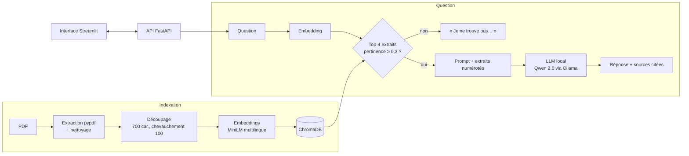

# 📚 DocuMind – Assistant IA (RAG) sur documents d'entreprise

> Posez une question en français sur les documents internes d'une entreprise (politiques RH, procédures, chartes) : DocuMind retrouve les passages pertinents et génère une **réponse sourcée** (document et page) avec un **LLM open source exécuté en local**. Aucune donnée ne sort de l'entreprise.


Exemple d'échange :

```
Question : « Combien est remboursée une nuit d'hôtel à Casablanca ? »
Réponse  : Une nuit d'hôtel à Casablanca est remboursée dans la limite de 900 dirhams [1].
Source   : 📄 procedure_notes_de_frais.pdf, page 1
```

## ✨ Fonctionnalités

- **Indexation de PDF** : extraction page par page, nettoyage des pieds de page, découpage en morceaux qui se chevauchent.
- **Recherche sémantique** : embeddings multilingues HuggingFace stockés dans **ChromaDB**.
- **Réponses sourcées** : le LLM cite les extraits utilisés (`[1]`, `[2]`) ; l'API renvoie le document, la page et un score de pertinence.
- **Pas d'invention** : si aucun extrait n'est assez pertinent, DocuMind répond « Je ne trouve pas cette information dans les documents fournis » **sans même appeler le LLM**.
- **Ajout de documents** à chaud par l'API ou l'interface (un fichier réindexé remplace ses anciens extraits).
- **Évaluation chiffrée** sur un jeu de 27 questions dont la réponse est connue.

## 🏗️ Architecture



**Choix techniques**
- **LLM local avec Ollama** (Qwen 2.5, 3 milliards de paramètres) : les documents internes ne sont jamais envoyés à un service externe, et le modèle tourne sur un PC sans GPU.
- **Embeddings multilingues** (`paraphrase-multilingual-MiniLM-L12-v2`) : adaptés au français, légers (CPU).
- **Similarité cosinus et seuil de pertinence** : une question hors sujet ne reçoit pas de réponse inventée.
- **Identifiants d'extraits stables** (`fichier:page:numéro`) : réindexer un document ne crée pas de doublons.
- **Prompt contraint** : réponse uniquement à partir des extraits, chiffres exacts, citation obligatoire.

## 📊 Évaluation

Le corpus de démonstration contient 5 politiques d'une **entreprise fictive** (télétravail, notes de frais, charte informatique, congés, guide d'accueil), générées par [`scripts/make_sample_docs.py`](scripts/make_sample_docs.py), car les vrais documents internes sont confidentiels.

Le jeu [`eval/questions.json`](eval/questions.json) contient **24 questions** dont la réponse se trouve dans les documents, et **3 questions hors sujet** (« Quel est le salaire du directeur général ? ») auxquelles l'assistant doit refuser de répondre.

| Mesure | Ce qu'elle vérifie | Résultat |
|---|---|---|
| Recherche hit@1 / hit@4 | Le bon document est-il le 1er extrait / parmi les 4 premiers ? | *à compléter* |
| MRR | Rang moyen du bon document (1 = toujours premier) | *à compléter* |
| Exactitude des réponses | Les informations attendues (« 900 », « 31 mars »…) sont-elles dans la réponse ? | *à compléter* |
| Exactitude des citations | La réponse cite-t-elle le bon document ? | *à compléter* |
| Abstention hors sujet | L'assistant refuse-t-il de répondre aux 3 questions hors corpus ? | *à compléter* |
| Latence médiane | Temps de réponse sur CPU | *à compléter* |

```bash
python -m documind.evaluate            # recherche + réponses (Ollama démarré)
python -m documind.evaluate --no-llm   # recherche seule
```

## 🛠️ Stack technique

| Domaine | Outils |
|---|---|
| RAG / LLM | **LangChain**, **Ollama** (Qwen 2.5), **ChromaDB**, embeddings **HuggingFace** (sentence-transformers) |
| Documents | pypdf |
| API / interface | **FastAPI**, Pydantic, **Streamlit** |
| Qualité | pytest (20 tests hors ligne), ruff |
| DevOps | **Docker**, Docker Compose, **GitHub Actions** |

## 🚀 Lancer le projet

### Avec Docker (le plus simple)

```bash
git clone https://github.com/mohammed-mrabet/documind.git
cd documind
docker compose up --build
```
- Interface : http://localhost:8501
- API et documentation Swagger : http://localhost:8000/docs

Le premier lancement télécharge le LLM (~2 Go). Sur un PC avec peu de mémoire (moins de 8 Go), choisissez un modèle plus léger :
`DOCUMIND_LLM_MODEL=qwen2.5:1.5b docker compose up --build`.

### En local

```bash
# 1. Installer Ollama (https://ollama.com) puis télécharger le modèle
ollama pull qwen2.5:3b

# 2. Environnement Python
python -m venv .venv && source .venv/bin/activate      # Windows : .venv\Scripts\activate
pip install -r requirements.txt -r requirements-dev.txt
export PYTHONPATH=src                                   # PowerShell : $env:PYTHONPATH="src"

# 3. Indexer, lancer l'API et l'interface
python -m documind.ingest
uvicorn documind.api:app --reload
streamlit run src/documind/app.py                       # dans un second terminal
```

### Tests

```bash
pytest
```
Les tests tournent **sans Internet ni GPU** : ils utilisent des embeddings lexicaux et un LLM simulé (`FakeListChatModel`), ce qui permet de tester toute la chaîne (indexation, recherche, citations, abstention, API) en moins de 2 secondes.

## 📡 API

```bash
curl -X POST http://localhost:8000/ask -H "Content-Type: application/json" \
     -d '{"question": "Combien de jours de télétravail sont autorisés ?"}'
```

| Méthode | Route | Description |
|---|---|---|
| POST | `/ask` | Pose une question ; renvoie la réponse, les sources (document, page, score, cité ou non) et la latence |
| GET | `/documents` | Documents indexés et nombre d'extraits |
| POST | `/documents` | Ajoute un PDF (20 Mo max) et l'indexe |
| GET | `/health` | État du service |

## 📁 Structure

```
documind/
├── data/docs/                   # PDF de démonstration (entreprise fictive)
├── eval/questions.json          # jeu d'évaluation
├── scripts/make_sample_docs.py  # génération des PDF
├── src/documind/
│   ├── loader.py                # extraction et nettoyage des PDF
│   ├── ingest.py                # découpage, embeddings, ChromaDB
│   ├── embeddings.py            # modèle HuggingFace (ou lexical pour les tests)
│   ├── rag.py                   # recherche + génération sourcée
│   ├── evaluate.py              # métriques de qualité
│   ├── api.py                   # API FastAPI
│   └── app.py                   # interface Streamlit
├── tests/                       # 20 tests hors ligne
└── Dockerfile, compose.yaml, .github/workflows/ci.yml
```

## 🔄 Intégration continue

À chaque `push`, GitHub Actions :
1. vérifie le code (ruff) et lance les tests hors ligne ;
2. indexe les documents avec le **vrai modèle d'embeddings** et **échoue si hit@4 < 0,9** ;
3. construit l'image Docker et vérifie que l'API démarre et indexe les documents.

## 🗺️ Pistes d'amélioration

- Recherche hybride (BM25 + embeddings) et reranking des extraits
- OCR pour les PDF scannés
- Réponses en streaming dans l'interface
- Gestion des droits : chaque utilisateur n'interroge que les documents auxquels il a accès

## 👤 Auteur

**Mohammed MRABET** – Master Ingénierie Informatique, Faculté des Sciences d'Oujda
[LinkedIn](https://www.linkedin.com/in/mohammed-mrabet-b3021b410/) · [GitHub](https://github.com/mohammed-mrabet)
